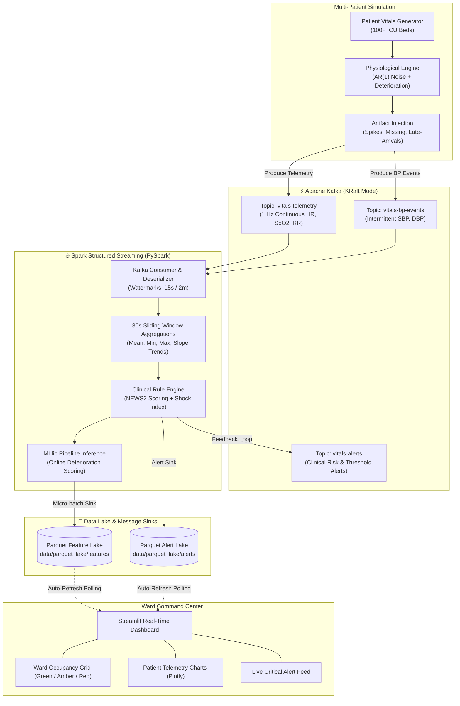

# 🏥 Real-Time ICU Healthcare Risk Prediction System

[](https://www.python.org/)
[](https://kafka.apache.org/)
[](https://spark.apache.org/)
[](https://streamlit.io/)
[](https://opensource.org/licenses/MIT)

An end-to-end, production-grade distributed streaming system designed to simulate an Intensive Care Unit (ICU) ward of concurrent patients, ingest continuous physiological telemetry through **Apache Kafka**, process and aggregate high-frequency vital signs using **Apache Spark Structured Streaming**, predict clinical deterioration risk online via **Spark MLlib**, and visualize real-time ward telemetry with an interactive **Streamlit** dashboard.

---

## 📐 System Architecture



---

## 🌟 Key Capabilities

1. **High-Fidelity ICU Patient Simulation (`generator/`)**:
   - Simulates 100+ concurrent ICU patients with individual physiological baselines.
   - Autoregressive AR(1) Gaussian noise models capturing natural biological variability.
   - Stochastic deterioration trajectories: **Septic Shock**, **Hypoxic Respiratory Failure**, and **Tachyarrhythmia Crisis**.
   - Realistic sensor noise, dropped packets (1%), motion artifacts (0.5%), and delayed arrivals (2%).
   - Parallel ground-truth labeling synchronized with streaming timestamps.

2. **Decoupled Messaging on Apache Kafka (`config/kafka_server_kraft.properties`)**:
   - Low-footprint Apache Kafka 3.8.1 deployment operating in **KRaft** consensus mode (ZooKeeper-less).
   - Dedicated partitioned topics: `vitals-telemetry` (6 partitions), `vitals-bp-events` (2 partitions), and `vitals-alerts` (2 partitions).

3. **Distributed Stream Processing (`streaming/`)**:
   - Continuous ingestion with PySpark Structured Streaming 3.5.3.
   - Event-time watermarking (15-second watermark for telemetry; 2-minute watermark for blood pressure).
   - Stateful sliding window aggregations (30-second windows sliding every 10 seconds).
   - Dynamic vital sign trend slopes ($\Delta HR$, $\Delta SpO_2$, $\Delta RR$).

4. **Dual Risk Assessment Layer**:
   - **Clinical Rule Baseline**: National Early Warning Score (NEWS2) computation, threshold anomaly detection, and Shock Index ($SI = \frac{HR}{SBP}$).
   - **Machine Learning Inference**: Pre-trained Spark MLlib pipeline (`Imputer` + `VectorAssembler` + `StandardScaler` + `RandomForestClassifier` / `LogisticRegression`) evaluating patient deterioration risk per micro-batch.

5. **Operational Ward Dashboard (`dashboard/app.py`)**:
   - Real-time ward monitoring grid with color-coded risk status (Normal, Moderate Risk, Critical).
   - Time-series vital trend visualization powered by Plotly.
   - Searchable, severity-filtered clinical alert stream with bed-level inspection.

---

## 📁 Repository Structure

```
.
├── config/
│   ├── config.yaml                    # Master system and hyperparameter configuration
│   └── kafka_server_kraft.properties  # Memory-tuned Kafka KRaft broker profile
├── data/
│   ├── ground_truth/                  # Generator-labeled patient outcomes
│   │   └── ground_truth_labels.csv    # Benchmark dataset for offline training
│   ├── parquet_lake/                  # Storage sink for streaming feature vectors
│   └── checkpoints/                   # Spark streaming recovery checkpoints
├── generator/
│   ├── __init__.py
│   ├── patient_state.py               # Patient entity & physiological baseline models
│   ├── scenarios.py                   # Pathological deterioration generators
│   ├── artifacts.py                   # Sensor dropouts, noise, and motion artifacts
│   └── producer.py                    # Multi-threaded Kafka telemetry producer
├── ml/
│   ├── __init__.py
│   ├── feature_pipeline.py            # Spark MLlib Feature Engineering Pipeline
│   ├── train.py                       # Offline model training, CV & serialization
│   └── models/
│       └── risk_pipeline_model/       # Serialized Spark MLlib PipelineModel
├── streaming/
│   ├── __init__.py
│   ├── schemas.py                     # StructType schemas for streaming payloads
│   ├── window_aggregations.py         # 30s sliding window aggregations & slopes
│   ├── alert_rules.py                 # NEWS2 score calculation & rule engine
│   └── pipeline.py                    # Main Spark Structured Streaming pipeline
├── dashboard/
│   ├── __init__.py
│   └── app.py                         # Streamlit multi-patient ward command center
├── implementation_plan.md             # Comprehensive architecture specification
├── requirements.txt                   # Pinned Python package dependencies
└── README.md                          # Project documentation and run guide
```

---

## 🚀 Quickstart Guide

### 1. Prerequisites
- **Python**: 3.9+ (tested on Python 3.9.13)
- **Java**: OpenJDK 17 or Oracle JDK 17 (`JAVA_HOME` set)
- **Apache Kafka**: 3.8.1 with KRaft support
- **OS**: Windows / Linux / macOS

### 2. Environment Setup

```bash
# Clone the repository
git clone https://github.com/notthatgeeky/Kafka-Healthcare-Risk-Prediction.git
cd Kafka-Healthcare-Risk-Prediction

# Create and activate virtual environment
python -m venv .venv
source .venv/bin/activate       # On Linux/macOS
# or: .venv\Scripts\activate   # On Windows

# Install dependencies
pip install -r requirements.txt
```

### 3. Initialize & Start Kafka KRaft Broker

```bash
# Format storage directory using a cluster UUID
kafka-storage.bat format -t <CLUSTER_ID> -c config/kafka_server_kraft.properties

# Start the Kafka Broker
kafka-server-start.bat config/kafka_server_kraft.properties
```

Create the required Kafka topics:
```bash
kafka-topics.bat --create --topic vitals-telemetry --bootstrap-server localhost:9092 --partitions 6 --replication-factor 1
kafka-topics.bat --create --topic vitals-bp-events --bootstrap-server localhost:9092 --partitions 2 --replication-factor 1
kafka-topics.bat --create --topic vitals-alerts --bootstrap-server localhost:9092 --partitions 2 --replication-factor 1
```

### 4. Run the Patient Vitals Generator

Launch the multi-threaded ICU vitals generator:
```bash
python -m generator.producer --patients 100 --speed 1.0
```

### 5. Start Spark Structured Streaming Pipeline

Run the streaming aggregation and ML inference pipeline:
```bash
python -m streaming.pipeline
```

### 6. Train or Re-train the Machine Learning Model (Optional)

```bash
python -m ml.train
```

### 7. Launch the Ward Dashboard

In a separate terminal, launch the Streamlit command center:
```bash
streamlit run dashboard/app.py
```
Open your browser at `http://localhost:8501`.

---

## ⚙️ Configuration Reference (`config/config.yaml`)

| Parameter | Default | Description |
|---|---|---|
| `kafka.bootstrap_servers` | `localhost:9092` | Kafka cluster broker endpoint |
| `generator.num_patients` | `100` | Number of active ICU ward beds simulated |
| `generator.telemetry_frequency_hz` | `1.0` | Ingestion frequency per patient (1 reading/sec) |
| `spark.trigger_interval_seconds` | `5` | Spark Structured Streaming micro-batch trigger |
| `spark.windows.duration` | `30 seconds` | Aggregation window duration |
| `spark.windows.slide` | `10 seconds` | Aggregation window slide step |
| `ml.risk_threshold_high` | `0.70` | Probability cutoff for critical deterioration alert |
| `ml.risk_threshold_medium` | `0.30` | Probability cutoff for moderate risk warning |

---

## 📊 Clinical Heuristics & Scoring

### National Early Warning Score (NEWS2)
The rule engine continuously evaluates physiological variables:
- **Respiration Rate (RR)**: $\le 8$ or $\ge 25$ bpm (Score 3)
- **Oxygen Saturation ($SpO_2$)**: $\le 91\%$ (Score 3)
- **Systolic Blood Pressure (SBP)**: $\le 90$ or $\ge 220$ mmHg (Score 3)
- **Pulse Rate (HR)**: $\le 40$ or $\ge 131$ bpm (Score 3)

### Shock Index (SI)
$$\text{Shock Index} = \frac{\text{Heart Rate (bpm)}}{\text{Systolic Blood Pressure (mmHg)}}$$
- Normal: $0.5 - 0.7$
- Moderate Shock: $> 0.7$
- Severe Hemodynamic Shock: $> 1.0$

---

## 📄 License
This project is licensed under the MIT License - see the LICENSE file for details.
