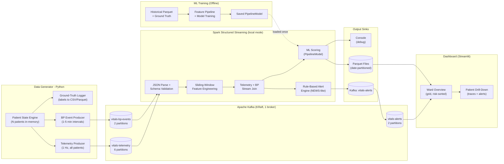

# Healthcare Risk Prediction - Implementation Plan

> **Course:** Big Data (M.Tech, AI and Data Science)
> **Scope:** Simulate an ICU ward of N patients, stream vitals through Kafka, process with Spark Structured Streaming, predict health risks with ML, and visualise results.
> **Environment:** Windows, Python 3.9.13, Java 17, Apache Kafka 3.8.1 (KRaft via KAFKA_HOME), PySpark 3.5.3 (pip in venv, no SPARK_HOME), 8 GB RAM laptop.

---

## Table of Contents

1. [Project Overview and Objectives](#1-project-overview-and-objectives)
2. [System Architecture](#2-system-architecture)
3. [Kafka Design](#3-kafka-design)
4. [Data Generator Design](#4-data-generator-design)
5. [Spark Structured Streaming Design](#5-spark-structured-streaming-design)
6. [Machine Learning Design](#6-machine-learning-design)
7. [Model Evaluation Plan](#7-model-evaluation-plan)
8. [Scalability Experiment](#8-scalability-experiment)
9. [Output and Visualisation](#9-output-and-visualisation)
10. [Folder Structure](#10-folder-structure)
11. [Config Design](#11-config-design)
12. [Resource Budget Table](#12-resource-budget-table)
13. [Step-by-Step Phased Roadmap](#13-step-by-step-phased-roadmap)
14. [Run Order and High-Level Commands](#14-run-order-and-high-level-commands)
15. [Risks and Limitations](#15-risks-and-limitations)
16. [Final Report and Presentation Guide](#16-final-report-and-presentation-guide)
17. [Open Questions](#17-open-questions)

---

## 1. Project Overview and Objectives

This project builds a **real-time patient monitoring and risk prediction pipeline** that mimics an ICU ward. The system:

1. **Generates** realistic vital-sign data for N concurrent patients (default 100, scalable to 500+) and pushes it through Apache Kafka at 1 Hz (telemetry) and at variable intervals (blood-pressure cuff events).
2. **Processes** the streams with Spark Structured Streaming - computing sliding-window statistics, detecting data-quality issues, and firing rule-based clinical alerts.
3. **Predicts** patient deterioration risk using a lightweight ML model (Spark MLlib) that scores every patient in every micro-batch.
4. **Displays** a real-time ward dashboard (Streamlit) and produces offline reports comparing ML models against a clinical rule-based baseline.

### Key learning outcomes

| Outcome | Demonstrated by |
|---|---|
| Big Data ingestion at scale | Kafka multi-topic, multi-partition streaming |
| Real-time stream processing | Spark Structured Streaming with event-time windows, watermarks, stateful ops |
| Applied ML on streaming data | Spark MLlib model trained offline, applied online per micro-batch |
| Scalability analysis | Empirical benchmarks at N = 10 to 500 on constrained hardware |
| Data engineering discipline | Schema design, data quality handling, Parquet storage, checkpoint management |

### Relationship to existing work

You already have a batch simulator (`simulate_patients.py`) that generates 100 readings per patient with AR(1) noise and deterioration scenarios, then saves everything to CSV. This plan **builds on that foundation** by:

- Keeping the AR(1) mean-reversion model and deterioration scenarios (cardiac stress, respiratory distress, sepsis).
- Splitting vitals into two separate streams (high-frequency telemetry vs. intermittent BP) to mirror real ICU monitors.
- Converting from batch CSV output to a real-time Kafka producer that ticks every second.
- Adding respiratory rate as a new vital (the existing simulator only has HR, SpO2, systolic/diastolic BP, and temperature).
- Adding sensor artifacts, late records, and patient admission/discharge dynamics.

---

## 2. System Architecture



### Component descriptions

| Component | Description |
|---|---|
| **Patient State Engine** | A single Python process holding in-memory state for all N patients (baselines, current vitals, active scenario, BP schedule). Iterates every 1 s. |
| **Telemetry Producer** | On each 1 s tick, builds a batch of N JSON messages (HR, SpO2, RR) and sends to `vitals-telemetry`, keyed by `patient_id`. |
| **BP Event Producer** | Maintains a per-patient BP timer. When a patient's timer fires (every 1-5 min), produces a BP reading to `vitals-bp-events`. |
| **Ground-Truth Logger** | Writes risk labels and scenario metadata to local CSV/Parquet for ML training and evaluation. |
| **Kafka Broker** | Single KRaft broker (`C:\kafka`) with three topics. Messages are keyed by `patient_id` for partition-level ordering. |
| **Spark Streaming** | Consumes both topics, parses JSON, computes sliding-window features, joins telemetry with BP, fires alerts, and applies the ML model. Runs in `local[2]` mode with 1-2 GB driver memory. |
| **Parquet Sinks** | Stores enriched features, predictions, and alerts in date-partitioned Parquet files for offline analysis and dashboard queries. |
| **ML Training** | Offline PySpark job that reads historical Parquet + ground-truth labels, trains Logistic Regression / Random Forest / GBT models, and saves the best PipelineModel. |
| **Streamlit Dashboard** | Reads the latest Parquet output and/or consumes `vitals-alerts`. Shows a ward-level grid (risk-sorted, colour-coded) and a single-patient drill-down. |

---

## 3. Kafka Design

### 3.1 Topics

| Topic | Purpose | Key | Partitions | Retention |
|---|---|---|---|---|
| `vitals-telemetry` | High-frequency vitals (HR, SpO2, RR) at 1 Hz per patient | `patient_id` | 6 | 1 hour (`retention.ms=3600000`) |
| `vitals-bp-events` | Intermittent BP readings (systolic, diastolic, MAP) | `patient_id` | 2 | 1 hour |
| `vitals-alerts` | Alerts produced by Spark (rule-based + ML risk scores) | `patient_id` | 2 | 6 hours |

### 3.2 Partition count rationale

- **Telemetry (6 partitions):** At N = 100 patients x 1 msg/s = 100 msg/s. Six partitions give Spark six parallel read tasks. At N = 500 (500 msg/s), six partitions still keeps each partition under 100 msg/s, well within a single broker's capacity. We pick 6 rather than fewer to give Spark enough parallelism without exceeding `spark.sql.shuffle.partitions` (set to 8).
- **BP events (2 partitions):** Much lower volume - at N = 100, roughly 0.5-1.7 msg/s on average. Two partitions are ample.
- **Alerts (2 partitions):** Output volume is a small fraction of input. Two partitions suffice.

### 3.3 KRaft broker configuration (low-memory)

The broker runs in KRaft mode (no ZooKeeper), which Kafka 3.8.1 fully supports. The broker installation location is resolved dynamically from the `KAFKA_HOME` environment variable (e.g., `%KAFKA_HOME%` in Windows Command Prompt or `$env:KAFKA_HOME` in PowerShell). Key memory settings:

```properties
# Key server.properties overrides (illustrative)
process.roles=broker,controller
node.id=1
controller.quorum.voters=1@localhost:9093
listeners=PLAINTEXT://localhost:9092,CONTROLLER://localhost:9093
log.dirs=kraft-combined-logs            # Relative to execution directory or %KAFKA_HOME%/kraft-combined-logs

# Low-memory retention
log.retention.hours=1
log.retention.bytes=536870912          # 512 MB total across all topics
log.segment.bytes=67108864             # 64 MB segments

# Reduce thread counts for single machine
num.network.threads=2
num.io.threads=4
num.partitions=2
```

Broker JVM heap: **512 MB** (`-Xmx512m` via `KAFKA_HEAP_OPTS`).

### 3.4 Message schemas (JSON)

**Telemetry message:**

```json
{
  "patient_id": "P0042",
  "bed_id": "BED-042",
  "device_id": "MON-042",
  "event_time": "2026-01-15T14:30:05.123Z",
  "heart_rate": 82.3,
  "spo2": 96.1,
  "respiratory_rate": 17.4,
  "risk_label": 0
}
```

**BP event message:**

```json
{
  "patient_id": "P0042",
  "bed_id": "BED-042",
  "device_id": "MON-042",
  "event_time": "2026-01-15T14:30:12.456Z",
  "systolic_bp": 128.5,
  "diastolic_bp": 78.2,
  "mean_arterial_pressure": 95.0,
  "risk_label": 0
}
```

**Alert message (Spark output):**

```json
{
  "patient_id": "P0042",
  "bed_id": "BED-042",
  "alert_time": "2026-01-15T14:30:10.000Z",
  "alert_type": "LOW_SPO2",
  "severity": "CRITICAL",
  "message": "SpO2 89.2% sustained below 90% for 10s",
  "ml_risk_score": 0.87,
  "ml_risk_level": "HIGH",
  "window_start": "2026-01-15T14:29:40.000Z",
  "window_end": "2026-01-15T14:30:10.000Z"
}
```

> [!NOTE]
> The `risk_label` field in telemetry and BP messages is the **ground-truth** label produced by the generator. In a real system this would not exist. We include it only for training and evaluation - Spark can either drop it before ML scoring or keep it in a side column for metrics computation.

### 3.5 Scaling in a real hospital

In production, this design would scale by:

- **More partitions:** Increase `vitals-telemetry` to 30-50 partitions for a 1000-bed hospital. Each partition handles ~20-30 patients.
- **Multiple brokers:** A 3-broker cluster with replication factor 3 for fault tolerance.
- **Spark cluster:** Replace `local[2]` with a YARN/Kubernetes cluster running multiple executors, each consuming a subset of partitions.
- **Schema Registry:** Replace raw JSON with Avro/Protobuf via Confluent Schema Registry for schema evolution and smaller payloads.
- Our single-machine design mimics this architecture in miniature. The `patient_id` key ensures the same partitioning strategy would work at any scale.

---

## 4. Data Generator Design

### 4.1 Overall approach

A **single Python process** with a tight timing loop simulates all N patients. No per-patient processes or threads for the simulation logic. An optional small thread pool (2-4 threads) may be used only for Kafka I/O (sending batches asynchronously).

This builds on your existing AR(1) simulator but converts it from a batch CSV writer into a real-time streaming producer.

### 4.2 Patient state model

Each patient is represented by a Python dataclass or dict holding:

| Field | Description |
|---|---|
| `patient_id` | `P0001` to `P{N:04d}` |
| `bed_id` | `BED-001` to `BED-{N:03d}` |
| `device_id` | `MON-001` to `MON-{N:03d}` |
| `baselines` | Dict of baseline HR, SpO2, RR, systolic BP, diastolic BP (drawn randomly per patient from realistic ranges) |
| `current_vitals` | Current HR, SpO2, RR (evolving via AR(1) each tick) |
| `current_bp` | Latest BP values |
| `active_scenario` | None, or one of: `hypoxia`, `tachycardia`, `hypotension`, `sepsis_like` |
| `scenario_timer` | Ticks remaining in current deterioration scenario |
| `bp_next_time` | Timestamp when next BP reading is due (1 min if unstable/alerted, up to 5 min if stable) |
| `admitted` | Boolean - whether patient is currently in a bed |
| `admit_time` | When the patient was admitted (for time-based features) |
| `risk_label` | Ground-truth label: 0 (stable) or 1 (deteriorating) |

### 4.3 Baseline generation

Each patient's baselines are drawn independently from clinically realistic distributions:

| Vital | Baseline Range | Distribution |
|---|---|---|
| Heart Rate | 55 - 95 bpm | Normal(75, 10), clipped |
| SpO2 | 94 - 100 % | Beta-shaped, median ~97% |
| Respiratory Rate | 12 - 20 breaths/min | Normal(16, 2), clipped |
| Systolic BP | 100 - 150 mmHg | Normal(120, 12), clipped |
| Diastolic BP | 60 - 95 mmHg | Normal(75, 8), clipped |

> [!TIP]
> By giving each patient a different baseline, the ML model must learn to detect **deviation from individual norms** rather than relying on absolute thresholds. This motivates the per-patient normalisation features described in section 6.

### 4.4 AR(1) mean-reversion dynamics (kept from existing simulator)

At each 1 s tick, for each vital `v` and patient `p`:

```
target = baseline[p][v] + scenario_shift[v]    # shift is 0 when stable
noise  = N(0, sigma_v)
value  = target + phi * (prev_value - target) + noise
value  = clamp(value, physiological_min, physiological_max)
```

Where `phi = 0.85` (AR coefficient) and `sigma_v` is the noise std for that vital. The `scenario_shift` is a smooth ramp that gradually shifts the target during deterioration (same ramp-up / peak / ramp-down approach from your existing code).

**Respiratory rate coupling:** When SpO2 drops below 93%, RR baseline is increased proportionally (the body's compensatory response), e.g., `RR_target += max(0, (93 - SpO2) * 0.8)`. This creates a realistic cross-vital correlation.

### 4.5 Physiological clamp ranges

| Vital | Min | Max |
|---|---|---|
| Heart Rate | 30 bpm | 200 bpm |
| SpO2 | 60% | 100% |
| Respiratory Rate | 4 breaths/min | 45 breaths/min |
| Systolic BP | 60 mmHg | 250 mmHg |
| Diastolic BP | 30 mmHg | 150 mmHg |
| MAP | 40 mmHg | 180 mmHg |

### 4.6 Dual-stream design

**Telemetry stream (1 Hz):**
- Every 1 second, all N patients produce one record each (HR, SpO2, RR).
- Records are batched and sent to `vitals-telemetry` as a single `producer.send()` burst.

**BP event stream (variable interval):**
- Each patient has an independent BP timer:
  - **Stable patient:** next BP in 3-5 minutes (random uniform).
  - **Deteriorating or alerted patient:** next BP in 1-2 minutes.
- When a patient's timer fires, produce one BP record to `vitals-bp-events`.
- This mirrors real ICU monitors where the NIBP cuff cycles automatically at configurable intervals.

### 4.7 Scenario injection

Scenarios are applied probabilistically across the population so that at any point in time, roughly **5-10%** of patients are deteriorating:

| Scenario | Vital shifts at peak | Duration |
|---|---|---|
| **Hypoxia** | SpO2 down 8-15%, HR up 15-25 bpm, RR up 5-10 | 60-180 s |
| **Tachycardia** | HR up 30-50 bpm, SpO2 down 1-3%, BP up 20-40 mmHg | 45-120 s |
| **Hypotension** | Systolic BP down 30-50 mmHg, HR up 10-20 bpm, SpO2 down 2-5% | 60-150 s |
| **Sepsis-like** | HR up 25-40 bpm, SpO2 down 5-10%, BP down 20-40 mmHg, RR up 5-12 | 120-300 s |

Scenario lifecycle:
1. Each tick, each stable patient has a small probability of starting a scenario (~0.001 per tick, or ~0.1% per second, which means on average one new event per ~17 minutes per 100 patients).
2. The scenario ramps up over 15-30 s, holds at peak, then recovers over 15-30 s.
3. After recovery, the patient returns to baseline with a cooldown period before another scenario can trigger.
4. `risk_label` is set to 1 during the active phase (ramp-up, peak, early recovery) and 0 otherwise.

### 4.8 Data quality challenges (for testing Spark's robustness)

| Challenge | How it is injected | Frequency |
|---|---|---|
| **Missing values** | Set one or more vitals to `null` in the JSON | ~1% of telemetry records |
| **Motion-artifact spikes** | Briefly spike HR or SpO2 to an extreme value for 1-2 s | ~0.5% of records |
| **Late records** | Delay sending some records by 5-15 s (stale `event_time`) | ~2% of records |
| **Out-of-order records** | Shuffle a few records within the batch | ~1% of batches |
| **Sensor dropout** | Stop producing records for a patient for 5-10 s | ~0.2% of time per patient |

### 4.9 Patient admission and discharge

To test dynamic scaling:
- The generator starts with N patients all admitted.
- Periodically (configurable, default every ~5 min), one patient is "discharged" (stops producing data) and a new patient is "admitted" (new baselines, new patient_id).
- Admission/discharge events are logged so Spark can handle patients appearing and disappearing from the stream.
- This feature is optional and disabled by default for simplicity; enabled via config.

### 4.10 Ground-truth labels

The generator writes a parallel ground-truth file (`ground_truth_labels.csv` or Parquet) containing:

| Column | Description |
|---|---|
| `patient_id` | Patient identifier |
| `event_time` | Timestamp of the label |
| `risk_label` | 0 = stable, 1 = deteriorating |
| `scenario` | Active scenario name or "none" |
| `scenario_phase` | "ramp_up", "peak", "recovery", or "stable" |
| `time_to_event_start` | Seconds until the next deterioration starts (for early-warning evaluation) |

This file is used for:
- Offline ML training (matching labels to windowed features by time).
- Streaming evaluation (comparing live predictions to ground-truth).

### 4.11 Timing loop

```
while running:
    tick_start = time.perf_counter()

    for patient in patients:
        update_vitals(patient)        # AR(1) step
        maybe_start_scenario(patient) # probabilistic injection
        maybe_inject_artifact(patient)

    batch = [build_telemetry_message(p) for p in patients if p.admitted]
    bp_batch = [build_bp_message(p) for p in patients if p.bp_due(now)]

    send_to_kafka(batch, topic="vitals-telemetry")
    send_to_kafka(bp_batch, topic="vitals-bp-events")
    write_ground_truth(patients, now)

    elapsed = time.perf_counter() - tick_start
    sleep(max(0, 1.0/speed_factor - elapsed))  # drift-free loop
```

### 4.12 Scale-test mode

A CLI flag controls the number of patients and a speed-up factor:

```
python generator/producer.py --patients 100 --speed 1    # real-time
python generator/producer.py --patients 500 --speed 5    # 5x faster for load testing
python generator/producer.py --patients 10  --speed 1    # quick dev/debug
```

The speed factor divides the sleep time, causing more data per wall-clock second.

---

## 5. Spark Structured Streaming Design

### 5.1 PySpark Execution Architecture & SparkSession Initialization

The pipeline uses **PySpark 3.5.3 installed via pip** inside a dedicated Python virtual environment (`.venv`). No external or separately installed Apache Spark binary distribution is used, and **`SPARK_HOME` is not required**.

#### 1. Runtime Environment & Environment Variables
- **Python Binding:** `PYSPARK_PYTHON` and `PYSPARK_DRIVER_PYTHON` are explicitly pointed to the virtual environment's Python executable (`.venv\Scripts\python.exe`). This ensures the Spark JVM driver and worker processes invoke the exact Python environment containing project dependencies.
- **Java Binding:** `JAVA_HOME` points to the installed JDK 17 (e.g., `C:\Program Files\Java\jdk-17`).
- **Windows Hadoop Native Libraries (`HADOOP_HOME` & `winutils`):**
  - **Issue:** On Windows, Apache Spark's underlying Hadoop FileSystem implementation requires native Windows utilities (`winutils.exe` and `hadoop.dll`) for POSIX file permission checks, file locking, and atomic commit coordinators. Without these, local writes to Parquet sinks and checkpoint directories will fail with `java.io.IOException` or `NullPointerException`.
  - **Mitigation:** A lightweight Hadoop binary directory is configured (e.g., `C:\hadoop`). `winutils.exe` and `hadoop.dll` (built for Hadoop 3.3.x / Java 17) are placed in `C:\hadoop\bin`. `HADOOP_HOME` is set to `C:\hadoop`, and `C:\hadoop\bin` is prepended to the system `PATH`.

#### 2. Kafka Connector Package Matching & Caching
- **Maven Coordinate:** `org.apache.spark:spark-sql-kafka-0-10_2.12:3.5.3`
- **Version Verification:** The connector version (`3.5.3`) and Scala binary version (`2.12`) must **match the pinned PySpark version (`3.5.3`) exactly**. The versions can be verified in PowerShell:
  ```powershell
  python -c "import pyspark; print('PySpark Version:', pyspark.__version__)"
  # Output: PySpark Version: 3.5.3 -> matches package coordinate :3.5.3
  ```
- **Dynamic Loading & Local Caching:** The connector is loaded in Python via `spark.jars.packages` in the `SparkSession` builder.
  - Internet access is required **only on the very first execution**.
  - Apache Ivy automatically resolves and downloads `spark-sql-kafka-0-10_2.12-3.5.3.jar` and its transitive dependencies (`kafka-clients`, `commons-pool2`, `spark-token-provider`), caching them in `%USERPROFILE%\.ivy2\jars\`.
  - Subsequent runs load directly from the local Ivy cache, enabling completely offline execution.

#### 3. SparkSession Builder Configuration
```python
from pyspark.sql import SparkSession

spark = (SparkSession.builder
    .appName("ICU-Risk-Prediction-Streaming")
    .master("local[2]")                                                     # 2 threads for 8GB laptop
    .config("spark.driver.memory", "1280m")                                 # Constrained heap
    .config("spark.sql.shuffle.partitions", "8")                            # Match Kafka partition count
    .config("spark.jars.packages", "org.apache.spark:spark-sql-kafka-0-10_2.12:3.5.3")
    .config("spark.sql.streaming.forceDeleteTempCheckpointLocation", "true")
    .getOrCreate())

spark.sparkContext.setLogLevel("WARN")
```

### 5.2 Source: Kafka Consumers

Two streaming DataFrames are instantiated via `readStream` from the local Kafka KRaft broker:

```python
# Telemetry stream: 1 Hz vitals
telemetry_df = (spark.readStream
    .format("kafka")
    .option("kafka.bootstrap.servers", "localhost:9092")
    .option("subscribe", "vitals-telemetry")
    .option("startingOffsets", "latest")
    .option("maxOffsetsPerTrigger", 2000)   # Safeguard against burst memory spikes
    .load())

# BP event stream: Intermittent cuff readings
bp_df = (spark.readStream
    .format("kafka")
    .option("kafka.bootstrap.servers", "localhost:9092")
    .option("subscribe", "vitals-bp-events")
    .option("startingOffsets", "latest")
    .option("maxOffsetsPerTrigger", 500)
    .load())
```

### 5.3 JSON Parsing with Explicit StructType Schemas

To avoid schema inference overhead and runtime parsing failures, explicit `StructType` schemas are enforced:

```python
from pyspark.sql.types import StructType, StructField, StringType, DoubleType, IntegerType, TimestampType

telemetry_schema = StructType([
    StructField("patient_id", StringType(), False),
    StructField("bed_id", StringType(), True),
    StructField("device_id", StringType(), True),
    StructField("event_time", TimestampType(), False),
    StructField("heart_rate", DoubleType(), True),
    StructField("spo2", DoubleType(), True),
    StructField("respiratory_rate", DoubleType(), True),
    StructField("risk_label", IntegerType(), True),
])

bp_schema = StructType([
    StructField("patient_id", StringType(), False),
    StructField("bed_id", StringType(), True),
    StructField("device_id", StringType(), True),
    StructField("event_time", TimestampType(), False),
    StructField("systolic_bp", DoubleType(), True),
    StructField("diastolic_bp", DoubleType(), True),
    StructField("mean_arterial_pressure", DoubleType(), True),
    StructField("risk_label", IntegerType(), True),
])
```

Payloads are extracted with `from_json(col("value").cast("string"), schema)`.

### 5.4 Event-Time Watermarks

Event-time watermarking bounds the in-memory state and drops excessively delayed records:

```python
telemetry_parsed = telemetry_parsed.withWatermark("event_time", "15 seconds")
bp_parsed = bp_parsed.withWatermark("event_time", "2 minutes")
```

- **Telemetry Watermark (15 s):** Accommodates simulated late packets (delayed 5–10 s) while purging expired windows quickly to preserve driver RAM.
- **BP Watermark (2 min):** Provides adequate time tolerance for intermittent cuff measurements.

### 5.5 Built-In Functions vs. Python UDFs (Strict Justification)

> [!IMPORTANT]
> **Strict Policy: Zero Python UDFs in the Streaming Critical Path.**
> All feature aggregations, trend slopes, and clinical alert rules are implemented using native Spark SQL functions (`pyspark.sql.functions`).

#### Technical Justification
1. **IPC & Serialization Overhead:** Python UDFs force PySpark to serialize DataFrame rows from off-heap JVM memory, transmit them across local socket IPC to a Python daemon worker process (`pyspark.daemon`), execute the function in Python, and serialize the result back across the socket to the JVM. For 100+ patients generating 100 msgs/sec, this creates severe micro-batch processing delays.
2. **Memory Footprint:** Each spawned Python worker process requires 150–250 MB of RAM. Under an 8 GB system budget, multiple worker processes risk triggering Windows page-file thrashing or OutOfMemory errors.
3. **Loss of Tungsten & Whole-Stage CodeGen:** Python UDFs act as black boxes to Spark's Catalyst optimizer, disabling vectorized execution, SIMD operations, and memory-efficient Tungsten bytecode generation.

#### Implementation of Trend Slopes without UDFs
Rather than invoking a Python linear regression function, the linear trend slope is computed using the closed-form Ordinary Least Squares (OLS) formula implemented purely with built-in Spark SQL aggregations:

$$\text{slope} = \frac{N \sum(t \cdot v) - \sum t \sum v}{N \sum(t^2) - (\sum t)^2}$$

Where:
- $t = \text{unix\_timestamp}(\text{event\_time})$ (seconds as double)
- $v = \text{vital sign value}$ (e.g., `heart_rate`, `spo2`)
- $N = \text{count}(*)$

In PySpark:
```python
import pyspark.sql.functions as F

# Pure built-in aggregation expressions:
t = F.unix_timestamp("event_time").cast("double")
v = F.col("heart_rate")

slope_expr = (
    (F.count("*") * F.sum(t * v) - F.sum(t) * F.sum(v)) /
    (F.count("*") * F.sum(t * t) - F.pow(F.sum(t), 2) + 1e-6)
).alias("hr_slope")
```

#### Implementation of NEWS Clinical Scores without UDFs
The National Early Warning Score is computed via chained built-in `F.when().when().otherwise()` Catalyst expressions, executing entirely inside JVM bytecode at zero serialization cost.

### 5.6 Sliding-Window Feature Engineering

Features are computed over 30-second windows sliding every 10 seconds, grouped by `patient_id`:

| Feature | Built-in Expression | Clinical Meaning |
|---|---|---|
| `hr_mean`, `hr_std`, `hr_min`, `hr_max` | `avg("heart_rate")`, `stddev("heart_rate")`, etc. | Cardiac stability & tachycardia |
| `spo2_mean`, `spo2_std`, `spo2_min` | `avg("spo2")`, `stddev("spo2")`, etc. | Hypoxemia detection |
| `rr_mean`, `rr_std`, `rr_slope` | `avg("respiratory_rate")`, OLS slope | Tachypnea / respiratory distress |
| `hr_slope`, `spo2_slope` | Built-in OLS slope formula | Rate of deterioration |
| `record_count`, `null_count` | `count("*")`, `sum(when(col("heart_rate").isNull(), 1).otherwise(0))` | Data hygiene indicators |

### 5.7 Telemetry + BP Stream Integration (Stateful Option B)

To avoid the memory overhead and unbounded state of a stream-stream interval join, the pipeline implements **Stateful BP Tracking (Option B)**:
- A stateful transformation (`flatMapGroupsWithState` or micro-batch broadcast lookup) maintains the single most recent BP event per patient (~200 bytes per patient in JVM memory, total $< 100\text{ KB}$ for 500 patients).
- When a 30s telemetry window completes, the patient's latest systolic BP, diastolic BP, and MAP are appended to form the complete feature row.
- Calculates derived hemodynamics:
  - $\text{Pulse Pressure} = \text{systolic\_bp} - \text{diastolic\_bp}$
  - $\text{Shock Index} = \text{hr\_mean} / \text{systolic\_bp}$

### 5.8 Data Quality Handling

Records failing physiological validation are tagged or excluded using built-in Spark SQL expressions:
- `heart_rate < 25 OR heart_rate > 230` $\rightarrow$ filter out as sensor artifact.
- `spo2 < 50 OR spo2 > 100` $\rightarrow$ filter out.
- Windows with `record_count < 10` (less than one-third expected records) are tagged with `low_data_quality=true`.

### 5.9 Rule-Based Alert Engine

Alert rules evaluate in parallel with the ML pipeline:
- **Critical Alerts:** `LOW_SPO2` (SpO2 mean $< 90\%$), `TACHYCARDIA` (HR $> 120$), `HYPOTENSION` (Systolic $< 90\text{ mmHg}$), `SHOCK` ($\text{Shock Index} \ge 1.0$).
- **Warning Alerts:** `LOW_SPO2_WARN` ($90\% \le \text{SpO2} < 93\%$), `TACHYPNEA` (RR $> 25$).
- Fired alerts are written immediately to the `vitals-alerts` Kafka topic and appended to `data/parquet_lake/alerts`.

### 5.10 Output Sinks & Parquet Compaction Strategy

1. **Kafka Sink (`vitals-alerts`):** Emits JSON alert payloads keyed by `patient_id` for consumption by the dashboard and alert monitors.
2. **Parquet Sink (`data/parquet_lake/features` & `alerts`):**
   - Date-partitioned (`date=YYYY-MM-DD`).
   - Trigger interval: `processingTime="5 seconds"` (or `10 seconds` for lower I/O).
   - Checkpoints written to `data/checkpoints/`.
3. **Parquet Compaction (`scripts/compact_parquet.py`):** Because micro-batches write small Parquet parts, a lightweight PySpark batch compaction job coalesces accumulated small files into 64–128 MB blocks at the end of each monitoring session.

### 5.11 PySpark Job Files Overview

The PySpark implementation consists strictly of four clean, focused Python scripts:

| Job File | Execution Type | Inputs (Reads) | Outputs (Writes) | Launch Command |
|---|---|---|---|---|
| `streaming/pipeline.py` | Streaming (Continuous) | - Kafka `vitals-telemetry`<br/>- Kafka `vitals-bp-events`<br/>- Saved MLlib `PipelineModel` | - Parquet `data/parquet_lake/features`<br/>- Parquet `data/parquet_lake/alerts`<br/>- Kafka `vitals-alerts`<br/>- Checkpoints `data/checkpoints/` | `python streaming\pipeline.py` |
| `ml/train.py` | Batch ML (Offline) | - Parquet historical features (`data/parquet_lake/features`)<br/>- Ground truth labels (`data/ground_truth/`) | - Fitted Spark MLlib `PipelineModel` saved to `ml/models/risk_pipeline_model/` | `python ml\train.py` |
| `ml/evaluate.py` | Batch ML (Offline) | - Test partition Parquet<br/>- Ground truth labels<br/>- Fitted `PipelineModel` | - Performance metrics summary (JSON/CSV)<br/>- Metric evaluation charts (`figures/`) | `python ml\evaluate.py` |
| `scripts/compact_parquet.py` | Batch Maintenance (Offline) | - Small Parquet parts in `data/parquet_lake/` | - Coalesced/compacted Parquet partition files | `python scripts\compact_parquet.py` |

---

## 6. Machine Learning Design

### 6.1 Prediction Goal and Problem Formulation

The machine learning component addresses the problem of **early detection of patient clinical deterioration**:

- **Task Type:** Binary classification per patient per sliding window (30-second window, evaluated every 5–10 seconds).
- **Target Label (`risk_label`):**
  - `0 (Stable)`: Vitals are fluctuating within baseline physiological ranges; no active acute distress.
  - `1 (Deteriorating)`: Patient is experiencing an acute deterioration scenario (hypoxia, tachycardia, hypotension, or sepsis-like decompensation).
- **Early-Warning Objective:** Predict risk **before** vitals breach hard clinical thresholds, giving clinical staff actionable lead time (15–60 seconds prior to peak crisis).
- **Secondary Output:** Calibrated probability score ($P(\text{deterioration}) \in [0.0, 1.0]$), mapped to clinical risk tiers:
  - `LOW` ($P < 0.30$)
  - `MEDIUM` ($0.30 \le P < 0.70$)
  - `HIGH` ($P \ge 0.70$)

### 6.2 Offline Training vs. Streaming Inference Architecture

```mermaid
flowchart TD
    subgraph Offline ["Phase A: Offline Model Training (Batch PySpark)"]
        O1["Historical Parquet Lake<br/>(Telemetry + BP Windows)"] --> O2["Ground Truth Labels<br/>(Time-aligned Join)"]
        O2 --> O3["Patient-Stratified Split<br/>(Train 70% / Val 15% / Test 15%)"]
        O3 --> O4["MLlib Pipeline:<br/>Imputer + Assembler + Scaler"]
        O4 --> O5["Model Search & Tuning:<br/>Logistic Regression, RF, GBT"]
        O5 --> O6["Model Evaluation & Selection<br/>(PR-AUC, F2-Score, Lead Time)"]
        O6 --> O7["Persist Spark MLlib<br/>PipelineModel to Disk (`models/risk_pipeline/`)"]
    end

    subgraph Online ["Phase B: Online Streaming Scoring (Spark Structured Streaming)"]
        S0["Driver Startup:<br/>PipelineModel.load('models/risk_pipeline/')"]
        S1["Kafka Micro-Batch<br/>(every 5s)"] --> S2["Window Feature<br/>Engineering Aggregations"]
        S2 --> S3["Attach Latest BP & Baselines<br/>(Stateful / MapGroupsWithState)"]
        S0 -.->|Broadcast / Cached Model| S4["model.transform(feature_df)<br/>(Native Spark MLlib inference)"]
        S3 --> S4
        S4 --> S5["Append Predictions to Parquet Sink"]
        S4 --> S6["Filter High Risk (P > 0.70) -> Publish to `vitals-alerts` Kafka"]
    end
```



#### Why Spark MLlib for Streaming?
Spark MLlib `PipelineModel` objects are natively compatible with Spark Structured Streaming DataFrames as long as the pipeline stages are **stateless transformers** (such as `VectorAssembler`, `StandardScalerModel`, and classification prediction models like `LogisticRegressionModel` or `RandomForestClassificationModel`). Loading the fitted `PipelineModel` on the driver and invoking `model.transform(stream_df)` executes distributed, low-latency scoring per micro-batch without converting data to Python/Pandas or invoking external REST APIs.

### 6.3 Feature Engineering Matrix

The feature vector combines **dynamic window statistics**, **cross-vital interactions**, **clinical indices**, and **patient baseline deviations**:

| Feature Name | Source | Description | Clinical Rationale |
|---|---|---|---|
| `hr_mean` | Telemetry (30s window) | Average heart rate | General tachycardia / bradycardia indicator |
| `hr_std` | Telemetry (30s window) | Heart rate variability across 30s | Sudden instability or arrhythmia |
| `hr_slope` | Telemetry (30s window) | Linear trend (bpm / sec) | Rapidly accelerating tachycardia |
| `spo2_mean` | Telemetry (30s window) | Average oxygen saturation (%) | Hypoxemia indicator |
| `spo2_std` | Telemetry (30s window) | SpO2 stability | Erratic desaturation |
| `spo2_slope` | Telemetry (30s window) | Linear trend (% / sec) | Steep desaturation trajectory |
| `rr_mean` | Telemetry (30s window) | Average respiratory rate (breaths/min) | Tachypnea / bradypnea |
| `rr_slope` | Telemetry (30s window) | Trend of respiratory rate | Rapid respiratory exhaustion |
| `systolic_bp` | BP State (latest) | Latest systolic cuff reading | Hemodynamic status |
| `diastolic_bp` | BP State (latest) | Latest diastolic cuff reading | Vascular resistance |
| `mean_arterial_pressure` | BP State (latest) | Calculated $(2 \times \text{DBP} + \text{SBP}) / 3$ | Organ perfusion adequacy (target > 65 mmHg) |
| `pulse_pressure` | Calculated | $\text{SBP} - \text{DBP}$ | Cardiac stroke volume indicator |
| `shock_index` | Cross-vital | $\text{hr\_mean} / \text{systolic\_bp}$ | **Critical ICU marker**: $> 0.9$ indicates imminent septic/hypovolemic shock |
| `spo2_to_rr_ratio` | Cross-vital | $\text{spo2\_mean} / \text{rr\_mean}$ | ROX-like index for respiratory failure |
| `hr_dev_baseline` | Baseline diff | $\text{hr\_mean} - \text{baseline\_hr}$ | Personalised cardiac deviation |
| `spo2_dev_baseline` | Baseline diff | $\text{baseline\_spo2} - \text{spo2\_mean}$ | Personalised desaturation from normal |
| `news_score` | Clinical Rule | Rule-based aggregate score (0 to 14) | Standard clinical baseline fed into ML |
| `data_quality_flag` | Data hygiene | Count of null or rejected readings in window | Alerts model to noisy or sensor-drop periods |

### 6.4 Algorithms Compared

Three supervised learning models from `pyspark.ml.classification` will be trained and compared against the rule-based clinical baseline:

1. **Baseline: Rule-Based NEWS Score**
   - Threshold classifier: If `news_score >= 5` or `shock_index >= 0.9`, predict 1; else 0.
   - Serves as the benchmark clinical gold standard.
2. **Logistic Regression (`LogisticRegression`)**
   - Highly interpretable odds ratios and feature weights.
   - Extremely fast micro-batch inference (< 5 ms per batch).
   - ElasticNet regularisation (`elasticNetParam=0.5`, `regParam=0.01`) to handle correlated vital signs.
3. **Random Forest Classifier (`RandomForestClassifier`)**
   - Ensembles 50 trees (`maxDepth=6`, `numTrees=50`).
   - Captures non-linear cross-vital interactions (e.g., moderate drop in BP coupled with moderate rise in HR).
   - Robust against outliers and sensor noise.
4. **Gradient-Boosted Trees (`GBTClassifier`)**
   - High predictive accuracy through sequential error correction (`maxIter=30`, `maxDepth=4`).
   - Evaluated for offline performance; evaluated for streaming inference latency tradeoff.

### 6.5 Handling Class Imbalance

In a realistic ward, deteriorating events represent only 5% to 10% of window observations. To prevent the model from trivially predicting class 0:

- **Class Weighting:** Compute inverse class frequencies:
  $$w_0 = \frac{N}{2 \cdot N_0}, \quad w_1 = \frac{N}{2 \cdot N_1}$$
  Pass a `weightCol` into Spark's `LogisticRegression` or downsample class 0 instances in the offline training DataFrame.
- **Metric Choice:** Never rely on Raw Accuracy. Optimise model hyperparameters based on **PR-AUC (Precision-Recall Area Under Curve)** and **$F_2$ score**.
- **Threshold Calibration:** Instead of a fixed 0.5 decision threshold, tune the probability threshold $\tau$ on the validation set to maximise $F_2$ (prioritising recall: catching 95%+ of deteriorating events while maintaining precision $> 70\%$).

### 6.6 Preventing Data Leakage

- **Patient-Level Stratification:** The train/validation/test split must partition by `patient_id` (e.g., Patients P0001–P0070 in Train, P0071–P0085 in Validation, P0086–P0100 in Test). Splitting randomly across rows would leak time-series correlations of the same patient between train and test sets.
- **Baseline Feature Isolation:** Baseline parameters are extracted strictly from each patient's initial calibration window or admission profile, never calculated across the entire dataset duration.

---

## 7. Model Evaluation Plan

### 7.1 Quantitative Metrics

Offline model evaluation will compute comprehensive performance tables:

| Metric | Formula / Definition | Target Value | Clinical Rationale |
|---|---|---|---|
| **Recall (Sensitivity)** | $\frac{TP}{TP + FN}$ | $> 0.92$ | In an ICU, a false negative (missed crash) is catastrophic. |
| **Precision (PPV)** | $\frac{TP}{TP + FP}$ | $> 0.75$ | High precision prevents "alarm fatigue" among nursing staff. |
| **$F_1$ Score** | $\frac{2 \cdot P \cdot R}{P + R}$ | $> 0.82$ | Harmonic balance between precision and recall. |
| **$F_2$ Score** | $\frac{5 \cdot P \cdot R}{4 \cdot P + R}$ | $> 0.88$ | Weights recall twice as heavily as precision. |
| **PR-AUC** | Area under Precision-Recall curve | $> 0.85$ | Accurate assessment under severe class imbalance. |
| **ROC-AUC** | Area under Receiver Operating Characteristic | $> 0.90$ | Discriminative ability across all thresholds. |

### 7.2 Lead Time Evaluation (Early-Warning Capability)

For all true-positive deterioration episodes, compute the **Lead Time**:
$$\Delta t_{\text{lead}} = t_{\text{threshold\_breach}} - t_{\text{first\_ml\_alert}}$$
- **Rule-based alerts** trigger only when vitals breach hard thresholds (e.g., SpO2 $< 90\%$).
- **ML early-warning model** triggers during the ramp-up phase based on slopes and multi-vital trends.
- **Evaluation target:** ML alerts provide a median lead time of **15 to 45 seconds** before hard threshold breaches.

### 7.3 Streaming Runtime Evaluation

| Metric | Target | Measurement Method |
|---|---|---|
| **Micro-Batch Processing Duration** | $< 2.5\text{ s}$ (on 5s trigger) | Spark Streaming query progress listener |
| **Scoring Latency per Batch** | $< 200\text{ ms}$ for 100 patients | Timer around `model.transform()` stage |
| **End-to-End Latency** | $< 6.0\text{ s}$ | $t_{\text{alert\_sink}} - t_{\text{event\_time}}$ |
| **Pipeline Memory Footprint** | $< 1.5\text{ GB}$ JVM Driver | JMX metrics / JVM heap profiler |

---

## 8. Scalability Experiment

### 8.1 Experiment Objectives

The scalability benchmark proves the pipeline's operational boundaries on a resource-constrained developer laptop (8 GB RAM) and demonstrates Big Data principles of horizontal scaling, partition saturation, and backpressure.

### 8.2 Experimental Matrix

| Experiment Run | Patient Count ($N$) | Kafka Ingestion Rate | Generator Speed | Partitions (Telemetry) | Trigger Interval |
|---|---|---|---|---|---|
| **Run 1 (Baseline)** | 10 patients | 10 msgs/sec | 1x (Real-time) | 2 | 5 seconds |
| **Run 2 (Ward Scale)** | 100 patients | 100 msgs/sec | 1x (Real-time) | 6 | 5 seconds |
| **Run 3 (ICU + Stepdown)** | 250 patients | 250 msgs/sec | 1x (Real-time) | 6 | 5 seconds |
| **Run 4 (Hospital Ward Scale)** | 500 patients | 500 msgs/sec | 1x (Real-time) | 6 | 5 seconds |
| **Run 5 (Stress Test / Burst)** | 100 patients | 500 msgs/sec | 5x speed-up | 6 | 5 seconds |

### 8.3 Measured Benchmark Metrics

For each run of 10 minutes duration, record:
1. **Input Rate vs. Processing Rate (msgs/sec):** Is the processing rate $\ge$ input rate, or does an unbounded lag build up?
2. **Micro-batch Processing Time (ms):** Monitored via `StreamingQueryProgress.batchDuration`.
3. **Consumer Lag:** Monitored via Kafka consumer group metrics (`kafka-consumer-groups.bat --describe`).
4. **CPU & Memory Profiling:**
   - Python Producer CPU % and RAM (MB).
   - Kafka Broker JVM heap and CPU %.
   - Spark Driver JVM heap and CPU %.
5. **Backpressure Behavior:** When speed is increased to 5x, verify that `maxOffsetsPerTrigger=2000` stabilizes the micro-batch size and prevents OutOfMemory errors.

---

## 9. Output and Visualisation

### 9.1 Streamlit Real-Time Ward Dashboard (`dashboard/app.py`)

A lightweight, responsive web interface built with Streamlit and Plotly that auto-refreshes every 3–5 seconds by reading the latest Parquet snapshots and Kafka alert stream:

```
+------------------------------------------------------------------------------------+
|  HOSPITAL WARD ICU MONITOR - REAL-TIME RISK PREDICTION DASHBOARD                   |
|  Active Patients: 100   |   Critical Alerts: 4   |   Streaming Latency: 1.8s       |
+------------------------------------------------------------------------------------+
| [ TAB 1: WARD OVERVIEW GRID ]  [ TAB 2: PATIENT DETAIL ]  [ TAB 3: BENCHMARKS ]   |
+------------------------------------------------------------------------------------+
|  Bed Matrix (10 x 10 Grid, Sorted by Risk):                                        |
|  [P0012: 0.94] RED     [P0045: 0.88] RED     [P0003: 0.72] RED   [P0081: 0.54] AMB |
|  [P0023: 0.41] AMB     [P0002: 0.12] GRN     [P0004: 0.08] GRN   [P0005: 0.05] GRN |
|  ...                                                                               |
+------------------------------------------------------------------------------------+
|  Recent Critical Alerts Feed:                                                      |
|  - 14:32:05 | P0012 (BED-012) | SEVERE HYPOXIA (SpO2: 86.4%, Risk: 0.94)          |
|  - 14:31:50 | P0045 (BED-045) | SEPTIC SHOCK RISK (Shock Index: 1.15, Risk: 0.88)   |
+------------------------------------------------------------------------------------+
```

- **Tab 1: Ward Overview Grid:** Visualises all $N$ beds as a dynamic grid. Each card displays `Bed ID`, `Patient ID`, `Current HR`, `SpO2`, `BP`, and `Risk Score`. Cards are colour-coded (Green = Low Risk $<0.30$, Amber = Medium Risk $0.30–0.70$, Red = High Risk $\ge 0.70$ / Critical Alert).
- **Tab 2: Patient Deep Dive:** Allows selecting any patient from a dropdown to view interactive multi-axis time-series plots:
  - Top Chart: Heart Rate and SpO2 traces with danger zones highlighted.
  - Middle Chart: Systolic, Diastolic, and MAP cuff readings.
  - Bottom Chart: ML Risk Probability trace vs. Rule-based NEWS score with alert timestamps overlaid.
- **Tab 3: System Telemetry & Big Data Metrics:** Real-time graphs showing Kafka ingestion throughput (records/sec), Spark micro-batch processing time over time, and Kafka topic consumer lag.

### 9.2 Offline Evaluation Visualisations

Exported as publication-quality static graphics (PNG/PDF) for the course report:
- `figures/roc_pr_comparison.png`: ROC and PR curves comparing Logistic Regression, Random Forest, GBT, and NEWS baseline.
- `figures/feature_importance.png`: Bar chart of top predictive features (Gini importance from Random Forest).
- `figures/scalability_throughput.png`: Line chart of throughput and batch processing time vs. patient count $N \in [10, 500]$.
- `figures/lead_time_distribution.png`: Histogram / boxplot of early-warning lead time.

---

## 10. Folder Structure

The project will be organized cleanly in `c:\Users\chitr\Take 2`:

```
c:\Users\chitr\Take 2\
│
├── config/
│   ├── config.yaml                    # Centralized system configuration
│   └── kafka_server_kraft.properties  # Low-memory KRaft broker settings
│
├── generator/
│   ├── __init__.py
│   ├── patient_state.py               # Patient entity, physiological baselines, AR(1) engine
│   ├── scenarios.py                   # Deterioration scenarios (hypoxia, tachycardia, sepsis)
│   ├── artifacts.py                   # Noise injection, sensor dropouts, motion artifacts
│   └── producer.py                    # Kafka producer (telemetry 1Hz + BP event loops)
│
├── streaming/
│   ├── __init__.py
│   ├── schemas.py                     # StructType schemas for telemetry, BP, and alerts
│   ├── window_aggregations.py         # Windowing, aggregations, trend slopes
│   ├── alert_rules.py                 # Clinical rule engine (NEWS-like & thresholds)
│   ├── state_manager.py               # Stateful BP attachment & patient baseline tracker
│   └── pipeline.py                    # Main Spark Structured Streaming application
│
├── ml/
│   ├── __init__.py
│   ├── feature_pipeline.py            # Feature assembler, imputer, scaler definitions
│   ├── train.py                       # Offline training script (CV, model search, export)
│   ├── evaluate.py                    # Offline test evaluation (PR-AUC, ROC, Confusion Matrix)
│   └── models/                        # Saved Spark MLlib PipelineModel directory
│       └── risk_pipeline_model/       # Serialized MLlib pipeline
│
├── dashboard/
│   ├── app.py                         # Streamlit multi-tab ward dashboard
│   ├── components.py                  # Plotly chart generators & ward grid cards
│   └── data_loader.py                 # Parquet & alert reader utilities
│
├── benchmarks/
│   ├── benchmark_runner.py            # Automated scalability test harness (N=10 to 500)
│   ├── metrics_collector.py           # System CPU, RAM, and Spark batch progress recorder
│   └── plot_benchmarks.py             # Generates scalability benchmark figures
│
├── scripts/
│   ├── setup_env.bat                  # Checks Java, Python, and Kafka prerequisites
│   ├── start_kafka.bat                # Formats KRaft storage and boots single broker
│   ├── create_topics.bat              # Creates vitals-telemetry, vitals-bp, vitals-alerts
│   ├── run_generator.bat              # Starts generator with configurable patient count
│   ├── run_streaming.bat              # Submits Spark streaming job with memory limits
│   └── compact_parquet.py             # Post-run small file compaction utility
│
├── data/
│   ├── ground_truth/                  # Parallel ground truth logs from generator
│   ├── parquet_lake/                  # Output sink: enriched features & predictions
│   │   ├── features/
│   │   └── alerts/
│   └── checkpoints/                   # Spark Structured Streaming state checkpoints
│       ├── telemetry_stream/
│       └── alert_stream/
│
├── figures/                           # Generated evaluation and benchmark plots
├── implementation_plan.md             # This document
├── requirements.txt                   # Pinned Python virtual environment dependencies
└── README.md                          # Comprehensive instructions and run guide
```

#### Pinned Dependencies (`requirements.txt`):
```text
# Spark Engine (pip-installed; provides full PySpark runtime, no SPARK_HOME required)
pyspark==3.5.3

# Kafka Producer Client (used in generator)
kafka-python==2.0.2

# Data Processing & Storage
pyarrow>=14.0.0
pandas>=2.0.0
numpy>=1.24.0
pyyaml>=6.0.1

# Visualization & Dashboard
streamlit>=1.35.0
plotly>=5.18.0
```

---

## 11. Config Design (`config/config.yaml`)

A single, centralized configuration file controls all pipeline parameters without requiring code modifications:

```yaml
# ==============================================================================
# Healthcare Risk Prediction - Master Configuration
# ==============================================================================

system:
  environment: "local"
  random_seed: 42
  log_level: "INFO"

kafka:
  bootstrap_servers: "localhost:9092"
  topics:
    telemetry:
      name: "vitals-telemetry"
      partitions: 6
      replication_factor: 1
      retention_ms: 3600000        # 1 hour
    bp_events:
      name: "vitals-bp-events"
      partitions: 2
      replication_factor: 1
      retention_ms: 3600000        # 1 hour
    alerts:
      name: "vitals-alerts"
      partitions: 2
      replication_factor: 1
      retention_ms: 21600000       # 6 hours

generator:
  num_patients: 100                # Default ward size
  speed_factor: 1.0                # 1.0 = real-time, >1.0 = accelerated benchmark
  telemetry_frequency_hz: 1.0      # 1 reading per second
  bp_interval_seconds_stable: [180, 300]   # 3 to 5 minutes
  bp_interval_seconds_alert: [60, 120]     # 1 to 2 minutes
  deterioration_probability_per_tick: 0.001
  data_quality:
    null_rate: 0.01                # 1% missing vitals
    spike_rate: 0.005              # 0.5% sensor motion spikes
    late_record_rate: 0.02         # 2% delayed records
    late_record_delay_seconds: 10

spark:
  master: "local[2]"
  app_name: "ICU-Risk-Prediction"
  driver_memory: "1280m"
  sql_shuffle_partitions: 8
  trigger_interval_seconds: 5
  watermarks:
    telemetry: "15 seconds"
    bp_events: "2 minutes"
  windows:
    duration: "30 seconds"
    slide: "10 seconds"
  max_offsets_per_trigger:
    telemetry: 2000
    bp_events: 500

ml:
  model_type: "RandomForest"       # LogisticRegression | RandomForest | GBT
  model_path: "ml/models/risk_pipeline_model"
  risk_threshold_high: 0.70
  risk_threshold_medium: 0.30
  train_test_split_ratio: 0.70
  class_weight_ratio: 9.0          # Balance factor for minority deteriorating class

paths:
  ground_truth_dir: "data/ground_truth"
  parquet_features_dir: "data/parquet_lake/features"
  parquet_alerts_dir: "data/parquet_lake/alerts"
  checkpoints_dir: "data/checkpoints"
  figures_dir: "figures"
```

---

## 12. Resource Budget Table (8 GB Laptop Constraint)

To ensure smooth, concurrent execution of all pipeline components on an 8 GB Windows laptop without thrashing or invoking the Windows paging file:

| Process / Component | Host Tech | Allocated RAM | JVM Heap / Limits | Rationale & Enforcement |
|---|---|---|---|---|
| **Windows OS & Background Services** | Native OS | ~3.0 – 3.2 GB | N/A | Windows 11 base kernel, IDE, and system processes |
| **Kafka Broker + KRaft Controller** | Java 17 | ~700 MB | `-Xms256m -Xmx512m` | Single JVM process, minimal internal thread pool (`KAFKA_HEAP_OPTS`) |
| **Spark Streaming Application** | PySpark / Java 17 | ~1.6 – 1.8 GB | `-Xms512m -Xmx1280m` | `spark.driver.memory=1280m`, `spark.master=local[2]` limits core contention |
| **Python Data Generator** | Python 3.9 | ~200 – 250 MB | Native OS heap | In-memory patient array, lightweight `kafka-python` batch producer |
| **Streamlit Dashboard** | Python 3.9 | ~200 – 250 MB | Native OS heap | Periodic cached Parquet queries via PyArrow |
| **Safety Headroom / OS Disk Cache** | Free RAM | ~1.5 – 1.8 GB | N/A | Prevents paging during micro-batch burst processing |
| **TOTAL** | | **~7.5 – 7.8 GB** | | **Strictly fits within 8.0 GB Physical RAM** |

---

## 13. Step-by-Step Phased Roadmap

### Phase 1: Environment & Kafka KRaft Verification
- Verify Python 3.9 and Java 17 (`JAVA_HOME` pointing to JDK 17).
- Verify Apache Kafka 3.8.1 installed locally and set `KAFKA_HOME` environment variable.
- Create project Python virtual environment (`python -m venv .venv`), activate it, and install pinned dependencies: `pip install -r requirements.txt` (including `pyspark==3.5.3` and `kafka-python==2.0.2`).
- Configure Windows Hadoop native libraries: place `winutils.exe` and `hadoop.dll` in `%HADOOP_HOME%\bin` and add to system `PATH`.
- Verify PySpark and Kafka connector version matching: `python -c "import pyspark; print(pyspark.__version__)"`.
- Format KRaft storage metadata using `%KAFKA_HOME%\bin\windows\kafka-storage.bat format`.
- Boot single-broker KRaft cluster and create the three topics (`vitals-telemetry`, `vitals-bp-events`, `vitals-alerts`).
- Run a quick Kafka console producer/consumer sanity check.

### Phase 2: Dual-Stream Data Generator & Ground Truth Engine
- Build `generator/patient_state.py` with individual patient baseline initialisation and AR(1) dynamics.
- Implement clinical deterioration scenarios (`scenarios.py`) with smooth ramp-up, peak, and recovery curves.
- Implement sensor artifacts, late arrivals, and missing value injection (`artifacts.py`).
- Implement `generator/producer.py` using `kafka-python` in `.venv`, producing 1 Hz telemetry and scheduled BP events to Kafka while streaming ground-truth records to local CSV/Parquet.
- Validate telemetry and BP schemas with unit tests.

### Phase 3: Spark Structured Streaming Core & Window Engineering
- Construct streaming source readers subscribing to `vitals-telemetry` and `vitals-bp-events` via `spark-sql-kafka-0-10_2.12:3.5.3`.
- Enforce explicit `StructType` schemas and parse JSON payloads.
- Implement event-time watermarking (15s telemetry, 2m BP).
- Build sliding-window aggregation logic (30s window, 10s slide) computing mean, min, max, std, and slope trends entirely using built-in Spark SQL functions (zero Python UDFs).
- Implement stateful BP attachment to windowed telemetry (Option B).
- Direct output to a temporary console sink to verify feature values.

### Phase 4: Rule-Based Clinical Alert Engine & Parquet Sink
- Implement NEWS score calculation and physiological threshold alert logic using native Spark Catalyst expressions.
- Emit critical alerts to `vitals-alerts` Kafka topic.
- Configure date-partitioned Parquet sink with checkpoint directory.
- Verify checkpoint recovery and micro-batch latency under standard 100-patient load.

### Phase 5: Offline Machine Learning Pipeline
- Run the generator to produce a 30-minute training dataset of Parquet features and aligned ground truth.
- Build PySpark ML pipeline in `ml/train.py` using `pyspark.ml`:
  - `VectorAssembler` of window features and clinical indices.
  - `StandardScaler` for normalisation.
  - Class-weighted `LogisticRegression`, `RandomForestClassifier`, and `GBTClassifier`.
- Evaluate models using `ml/evaluate.py` (PR-AUC, ROC-AUC, $F_2$ score, Confusion Matrix).
- Save the winning `PipelineModel` to `ml/models/risk_pipeline_model`.

### Phase 6: Online Streaming ML Scoring Integration
- Load the trained `PipelineModel` in `streaming/pipeline.py` during Spark driver startup.
- Apply `model.transform(window_features)` within the streaming execution graph (native MLlib streaming scoring).
- Attach model risk probabilities ($P(\text{deterioration})$) to the streaming DataFrame.
- Route high-risk predictions ($P \ge 0.70$) into `vitals-alerts` Kafka topic and write enriched records to Parquet.

### Phase 7: Streamlit Ward Monitoring Dashboard
- Develop `dashboard/app.py` with live ward grid, patient detail charts, and alert feeds.
- Verify low-latency data polling from Parquet and alerts from Kafka.
- Add real-time UI controls to filter beds by risk severity (High / Medium / Low).

### Phase 8: Scalability Experiments & Benchmarking
- Execute `benchmarks/benchmark_runner.py` across $N = 10, 50, 100, 250, 500$ patients.
- Capture micro-batch duration, processing throughput, and consumer lag.
- Profile CPU and memory consumption.
- Generate comparative scalability figures with `benchmarks/plot_benchmarks.py`.

### Phase 9: Evaluation Report, Figures & Final Documentation
- Generate all visual artifacts (ROC curves, PR curves, feature importance, lead-time histograms, benchmark charts).
- Document results, clinical insights, architecture justifications, and lessons learned.
- Package instructions and video/demo script for course presentation.

---

## 14. Run Order and High-Level Commands

To run the complete system, four separate Windows PowerShell terminals are opened in sequence:

### Terminal 1: Kafka KRaft Broker
```powershell
# Set Kafka heap and boot KRaft broker using KAFKA_HOME
$env:KAFKA_HEAP_OPTS = "-Xms256m -Xmx512m"
& "$env:KAFKA_HOME\bin\windows\kafka-server-start.bat" config\kafka_server_kraft.properties
```

### Terminal 2: Data Generator (Simulation Engine)
```powershell
# Activate project virtual environment
.\.venv\Scripts\Activate.ps1

# Create topics (first run only)
.\scripts\create_topics.bat

# Start patient simulation (100 patients, real-time 1 Hz)
python generator\producer.py --patients 100 --speed 1.0
```

### Terminal 3: PySpark Structured Streaming & Online ML Inference
```powershell
# Activate project virtual environment
.\.venv\Scripts\Activate.ps1

# Ensure Spark driver and worker processes bind to venv Python
$env:PYSPARK_PYTHON = "$PWD\.venv\Scripts\python.exe"
$env:PYSPARK_DRIVER_PYTHON = "$PWD\.venv\Scripts\python.exe"

# Launch PySpark streaming job directly (PySpark engine initializes via pip package)
python streaming\pipeline.py
```

### Terminal 4: Streamlit Ward Dashboard
```powershell
# Activate project virtual environment and launch dashboard
.\.venv\Scripts\Activate.ps1
streamlit run dashboard\app.py --server.port 8501
```

---

## 15. Risks, Limitations, and Mitigations

| Risk / Challenge | Potential Impact | Technical Mitigation |
|---|---|---|
| **Windows Hadoop File Locking** | Spark local checkpoint or Parquet writes fail with `java.io.IOException` on Windows | Place `winutils.exe` and `hadoop.dll` in `%HADOOP_HOME%\bin`, add to system `PATH`, and ensure all checkpoint paths use standard local URI notation (`file:///C:/...`). |
| **Python UDF Performance Bottleneck** | Row-by-row socket serialization causes micro-batch latency delays | Enforce a strict **zero Python UDF policy** in streaming: compute slopes and NEWS scores using native Spark SQL built-in aggregations and expressions. |
| **Kafka Connector Version Mismatch** | `ClassNotFoundException` or NoSuchMethodError when reading Kafka stream | Ensure the Maven package string `org.apache.spark:spark-sql-kafka-0-10_2.12:3.5.3` matches the pinned `pyspark==3.5.3` version exactly. Cached locally in `%USERPROFILE%\.ivy2\jars\`. |
| **Memory Exhaustion (OOM) on 8 GB RAM** | System freezes or JVM exits with `OutOfMemoryError` | Strict JVM heap limits (Kafka: 512 MB, Spark: 1280 MB), `local[2]` thread cap, `maxOffsetsPerTrigger=2000`, and state cleanup via watermarks. |
| **Small File Problem in Parquet Sink** | Thousands of tiny Parquet files created every 5s micro-batch degrade read performance | Use trigger interval of 5–10s for feature sink, date-partitioning (not per-patient), and run `compact_parquet.py` post-session to coalesce into 64 MB files. |
| **Severe Class Imbalance** | ML model predicts all patients as stable (0% recall on emergencies) | Apply class weights in training, evaluate on PR-AUC / $F_2$ score, and tune probability decision threshold $\tau$ rather than default 0.5. |
| **Stream-Stream Join Latency / State Bloat** | Joining high-frequency telemetry with low-frequency BP consumes unbounded Spark state | Prefer **Option B (Stateful latest-BP tracker)**: carry the single latest BP reading per patient (~200 bytes) in state rather than performing an unbounded interval join. |
| **Data Leakage in Time-Series** | Overoptimistic model accuracy due to patient overlap across train/test splits | Strictly partition dataset by `patient_id` during train/val/test splitting. |

---

## 16. Final Report and Presentation Guide

For the M.Tech Big Data course submission and defense, the project report and presentation slides should follow this academic and engineering structure:

1. **Title & Abstract:** Real-Time ICU Ward Risk Prediction using Apache Kafka, Spark Structured Streaming, and Spark MLlib.
2. **Motivation & Clinical Context:** High-frequency vital monitoring in ICUs; the challenge of alarm fatigue; why early warning leads to better patient outcomes.
3. **System Architecture & Big Data Rationale:**
   - Why Kafka: Decoupling high-frequency data ingestion from processing; multi-partition parallelism; durability.
   - Why Spark Structured Streaming: Unified DataFrame API, event-time semantics, stateful sliding windows, native MLlib integration, zero Python UDF overhead.
4. **Data Simulation Methodology:**
   - Multi-parameter modeling (HR, SpO2, RR at 1 Hz; BP at 1–5 min).
   - AR(1) mean-reversion with coupled physiological responses (e.g., hypoxic tachycardia and tachypnea).
   - Realistic data quality challenges (sensor artifacts, dropouts, late data).
5. **Machine Learning & Clinical Rule Integration:**
   - Feature engineering (slopes, variability, Shock Index, NEWS score).
   - Comparative evaluation: Rule-based NEWS vs. Logistic Regression vs. Random Forest vs. GBT.
   - Trade-offs: Interpretability vs. non-linear accuracy vs. streaming inference latency.
   - Early warning lead-time analysis.
6. **Scalability & Performance Benchmarks:**
   - Ingestion throughput and micro-batch latency curves across $N = 10$ to $500$ patients.
   - Memory and CPU footprint analysis under memory constraints.
   - Identification of bottlenecks and optimization tuning.
7. **Demonstration & Dashboard Walkthrough:**
   - Live demo of ward overview grid, patient drill-down traces, and real-time alert triggering.
8. **Conclusion & Future Directions:**
   - Scaling to multi-node clusters, Schema Registry integration, and deep learning sequence models (LSTM / Transformer).

---

## 17. Open Questions and Design Decisions for Review

Before writing implementation code, please review these architectural choices:

1. **Windows Hadoop Binaries (`winutils.exe`):** Do you already have `winutils.exe` and `hadoop.dll` under a specific folder (e.g., `C:\hadoop\bin`), or should we include a lightweight PowerShell setup script in Phase 1 to download and configure them in `HADOOP_HOME`?
2. **Preferred ML Model for Streaming Inference:** For online scoring in the streaming pipeline, do you prefer **Logistic Regression** (fastest, simplest, fully interpretable) or **Random Forest** (captures multi-vital interactions, slightly higher compute per micro-batch)? *(We will train both offline and select the best).*
3. **BP Join Approach:** Confirming adoption of **Option B (Stateful latest-BP cache)** for attaching BP readings to 30s telemetry windows to conserve memory and simplify the streaming graph.
4. **Dashboard Polling Rate:** Is a 3-second refresh interval for the Streamlit dashboard acceptable for your presentation requirements?

